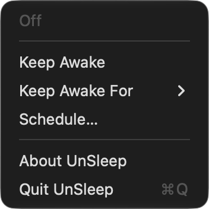
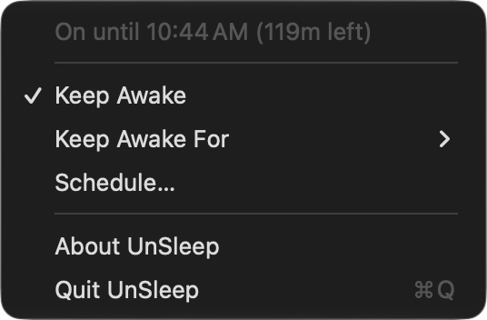
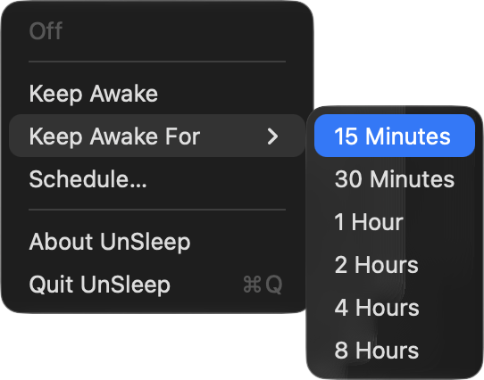
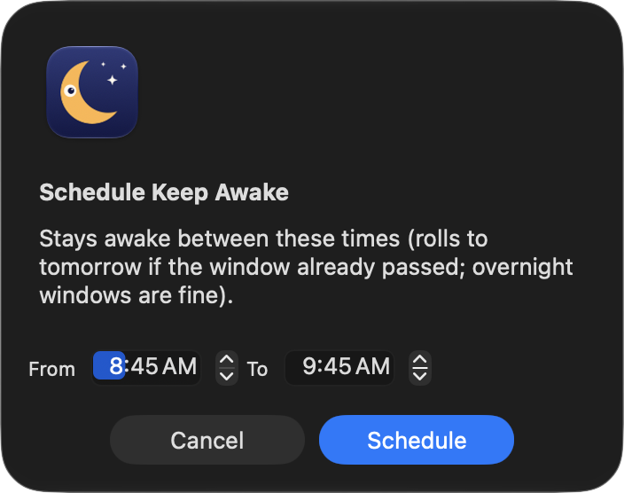
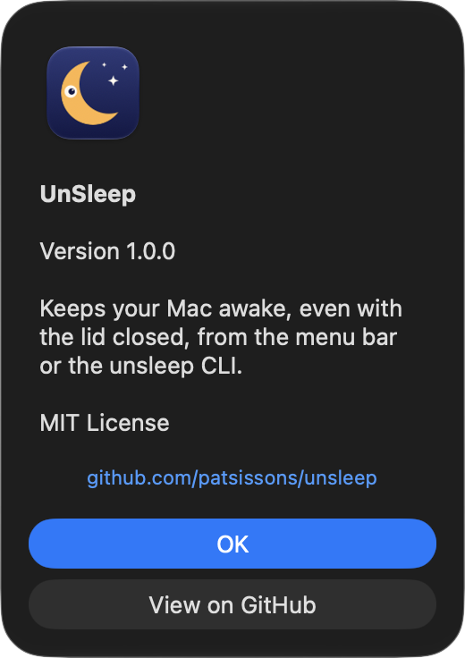

<p align="center">
  
</p>

# UnSleep

A tiny macOS menu bar app and CLI that keeps your Mac awake—even with the
lid closed.

> [!WARNING]
> UnSleep bypasses macOS’s intended lid-close sleep behavior. This is mostly
> okay, but for legal reasons :tm:, keeping your Mac awake with the lid closed can
> trap heat that would otherwise escape through the keyboard and hinge,
> increasing the risk of overheating and battery drain. Please use this feature
> sparingly and with caution. Prefer timed and non-intensive tasks. Where
> possible, keep the lid open or use Apple’s supported clamshell setup while
> connected to power.

## Install

```bash
curl -fsSL https://raw.githubusercontent.com/patsissons/unsleep/main/install.sh | bash
```

This builds UnSleep from source and installs `~/Applications/UnSleep.app` and
`~/.local/bin/unsleep`, then launches the app. Nothing is cloned: the source
downloads to a temporary directory that's deleted after the build. Run the
same command again to update.

The installer checks its dependencies first. The only one that might be
missing is the Xcode Command Line Tools, which provide the Swift compiler. If
they're missing, it offers to install them (a ~1–2 GB download that usually
takes 5–20 minutes) and continues when they finish.

To pin or roll back to a tag, branch, or commit:

```bash
curl -fsSL https://raw.githubusercontent.com/patsissons/unsleep/main/install.sh | UNSLEEP_INSTALL_REF=<ref> bash
```

From a clone, run `./install.sh` to build and install that working tree.

## Menu bar app

Use the menu bar icon to:

- toggle **Keep Awake**
- choose a duration from **Keep Awake For**
- **Schedule** a start and end time
- see version info and a link to this repo in **About UnSleep**

<p align="center">
  
  &nbsp;
  
</p>

<p align="center">
  
</p>

<p align="center">
  
  &nbsp;
  
</p>

Turning UnSleep off or quitting restores the sleep settings it changed. To
start it at login, add `UnSleep.app` in **System Settings → General → Login
Items**.

## CLI

The CLI shares state with the menu bar app. Commands that change state launch
the app when needed.

```bash
unsleep on                              # stay awake until turned off
unsleep on --for 2h                     # stay awake for a duration
unsleep on --until 17:30                # stay awake until a time
unsleep on --from 13:00 --until 15:00   # schedule a window
unsleep off                             # restore sleep and cancel schedules
unsleep status                          # print the current state
unsleep status --json                   # machine-readable state
```

### Coding agents

The CLI is useful for agents that run unattended. For example, an agent
harness hook can run `unsleep on` when a session starts and `unsleep off` when
it shuts down, keeping your Mac awake for the session. Use `--for` if you
also want a safety cutoff.

## Password-free mode

UnSleep uses `pmset`, so macOS asks for an admin password on each toggle by
default. On first launch, enable password-free mode when prompted, or choose
**Set Up Password-Free Mode…** from the menu.

> [!NOTE]
> Password-free mode is intentionally narrow. It only allows these three sleep
> commands to run without a password:
>
> - `sudo /usr/bin/pmset -b sleep 0` — set battery idle sleep to never
> - `sudo /usr/bin/pmset -b disablesleep 1` — block sleep while on battery,
>   including lid-close sleep
> - `sudo /usr/bin/pmset -b disablesleep 0` — remove that sleep block
>
> These commands only change sleep settings. They do not grant broader admin
> access or access to your files, so password-free mode is low risk.

You can also enable it from the terminal, no clone needed:

```bash
curl -fsSL https://raw.githubusercontent.com/patsissons/unsleep/main/install-sudoers.sh | sudo bash
```

This runs [`install-sudoers.sh`](install-sudoers.sh) as root, so you may want
to read it first. From a clone, run `sudo ./install-sudoers.sh` instead.

This adds a validated sudoers rule for UnSleep's three exact `pmset` commands.
Remove it anytime:

```bash
sudo rm -f /etc/sudoers.d/unsleep
```

## Uninstall

```bash
unsleep off
osascript -e 'quit app "UnSleep"'
rm -rf ~/Applications/UnSleep.app ~/.local/bin/unsleep
sudo rm -f /etc/sudoers.d/unsleep
```

## License

[MIT](LICENSE)
